# Edgi Smart Home 产品与工程架构说明

GitHub 仓库：[ARongvv/edgi_smart_home](https://github.com/ARongvv/edgi_smart_home)

演示视频：[Bilibili · Edgi Smart Home](https://www.bilibili.com/video/BV1AXsV6rEYW/)

> 基于 RT-Thread 与 Infineon PSoC Edge E84（Edgi-Talk）的端云协同智能家居中控
>
> 更新日期：2026-11-14

---

## 1. 产品概述

Edgi Smart Home 是一款带触摸屏的家庭智能中控面板，通过自然语言与屏幕按钮管理家庭设备。工程提供本地设备模型、房间与场景管理，并通过家庭局域网网关接入米家设备，支持摄像头云台校准等操作。

产品的核心主张是：

> **智能能力可以上云，但基础控制必须在本地。**

本地触摸、设备模型与设置入口独立于云端服务。`set_light`、`set_ac` 用于本地演示模型，米家设备通过网关控制。

### 1.1 目标用户

| 用户类型 | 主要诉求 |
| --- | --- |
| 家庭用户 | 少装 App、少记按钮，用一句话或点两下完成控制 |
| 智能家居爱好者 | 本地设备与米家设备统一管理，断网仍可用 |
| 嵌入式开发者 | 可复用的 Agent 中控参考工程，便于替换设备与模型 |

### 1.2 产品定位

- 定位为**家庭中控面板**，统一管理房间、设备与场景。
- 交互以**文字 + 触摸**为主，界面主要使用英文，米家设备名、房间与能力项支持中文。
- 智能部分采用**云端大模型 + 板端 Agent 编排**，板端负责工具执行与状态管理。
- 板端通过**家庭局域网网关**接入米家设备，由网关连接厂商服务与设备。

---

## 2. 硬件框架

### 2.1 板卡与 SoC

产品运行在 **Edgi-Talk** 开发板上，核心为 Infineon **PSoC Edge E84**（PSE84）异构 SoC：

| 组成 | 规格 | 在产品中的角色 |
| --- | --- | --- |
| 应用核 | Cortex-M55，400 MHz | 运行 RT-Thread、LVGL 界面、Agent、网络与设备服务 |
| 协同核 | Cortex-M33，200 MHz | 承担官方启动链与无线协同 |
| 无线 | CYW55500 Wi-Fi 模组 | 家庭 Wi-Fi 接入、局域网访问与云端通信 |
| 显示 | 800×480 RGB565 LCD，横屏 | 中控主界面、房间页、对话页与设置页 |
| 触摸 | 电容触摸面板 | 点按、页面切换、软键盘输入 |
| 音频 | 16 kHz / 16 bit / 单声道 | 提示音与语音链路的硬件预留 |
| 存储 | QSPI NOR Flash | 固件、LittleFS 文件系统与运行时资源 |
| 运行内存 | SOCMEM 堆 + HyperRAM | LVGL 对象及业务分配；当前为大块业务数据配置独立 2 MiB HyperRAM bulk 池 |
| 调试与串口 | KitProg3（SWD + UART） | 烧录、115200 8N1 日志与演示命令 |

M55 承载图形界面和 Agent，M33 与无线模组由官方 BSP 维护。

### 2.2 存储与外设

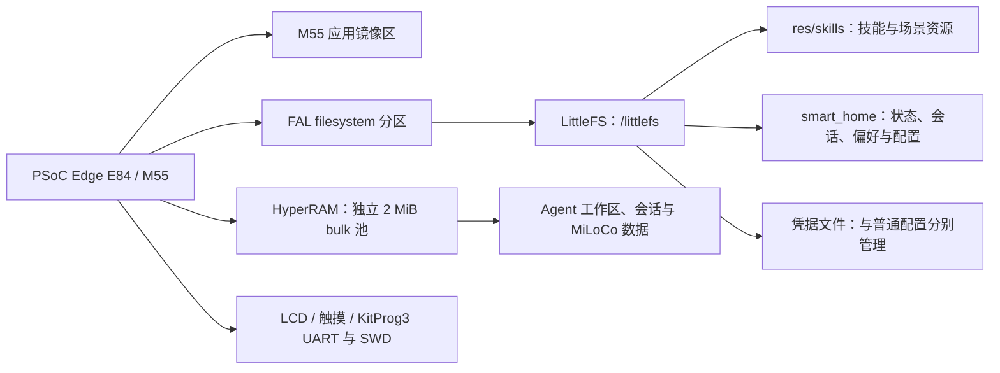

*图 2-1　应用镜像、LittleFS 文件布局与运行内存。*

| 区域 | 内容 | 管理方式 |
| --- | --- | --- |
| M55 应用镜像区 | RT-Thread、LVGL、Agent、业务与编入固件的资源 | 使用官方启动链与链接布局 |
| `filesystem` 分区 | LittleFS，挂载到 `/littlefs` | 配置、资源、会话等共享该文件系统；挂载失败记录错误，不自动格式化 |
| `/littlefs/res/skills/` | 技能说明、场景目录 | 按版本部署与解析 |
| `/littlefs/smart_home/` | 状态、配置、会话、用户偏好及凭据文件 | 普通配置与凭据分别管理 |
| HyperRAM bulk 池 | Agent、会话、模型缓冲、MiLoCo 等大块分配 | 独立配置 2 MiB 内存池 |

板级初始化按存储、显示、触摸、音频、Wi-Fi 的顺序记录就绪状态，应用启动流程见第 6.3 节。

### 2.3 外设与网络

网络采用“无线模组 → RT-Thread 网络栈 → 应用协议”的分层结构：

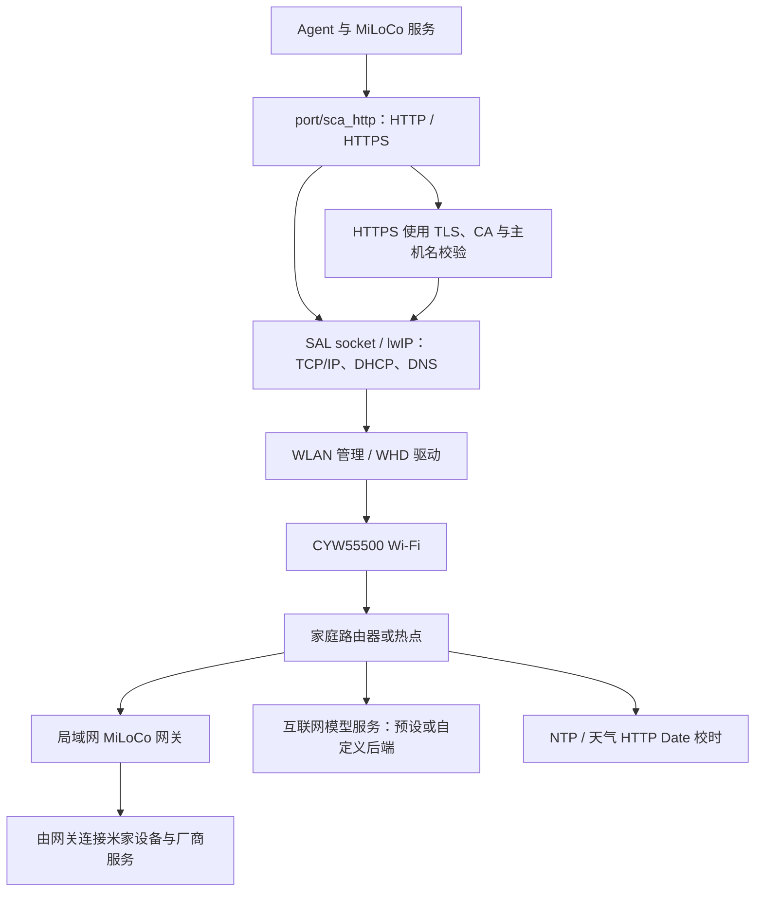

*图 2-2　板端网络分层与服务出口。*

| 网络能力 | 承载方式 | 产品表现 |
| --- | --- | --- |
| Wi-Fi 连接 | WLAN 管理 + DHCP | 设置页配置，后台自动连接与断线重连 |
| 局域网访问 | lwIP + SAL | 访问已配置的 MiLoCo 网关，读取设备、能力并提交控制 |
| 云端访问 | HTTPS（TLS + CA 校验） | 文字对话与模型服务 |
| 时间同步 | NTP；天气 HTTP 响应的 Date 校时路径 | 校准系统时间，供 TLS 证书有效期检查与界面时钟使用 |
| 状态反馈 | 网卡、IP、在线状态 | 首页与设置页展示网络健康度 |

网络状态由 Wi-Fi、IP 与 DNS 探测结果汇总。模型服务与米家网关分别记录连接状态；HTTPS 使用 CA 与主机名校验。

### 2.4 硬件能力与产品功能的对应

| 硬件能力 | 支撑的产品功能 |
| --- | --- |
| M55 应用核 | 界面渲染、Agent 编排、并发网络与设备服务 |
| LCD + 触摸 | 房间卡片、对话、设置与场景操作 |
| QSPI + LittleFS | 设备状态恢复、配置保存、会话与资源 |
| CYW55500 | Wi-Fi 配网、云端对话、米家局域网接入 |
| KitProg3 UART | 现场演示、状态检查与问题定位 |
| 音频 | 后续语音交互的硬件预留 |

---

## 3. 产品功能

### 3.1 核心功能

| 功能 | 用户看到的效果 |
| --- | --- |
| 房间与设备管理 | 按房间展示本地状态模型及网关同步的米家设备，区分来源与观测状态 |
| 触摸控制 | 按设备实际能力生成控件；米家操作显示等待、确认、失败或未确认 |
| 文字对话 | 模型生成工具调用，板端校验后执行，并根据实际回执反馈结果 |
| 场景控制 | 一键执行回家、离家、睡眠等组合场景 |
| 米家设备接入 | 配置网关并完成账号绑定，同步设备及能力，执行摄像头云台校准等操作 |
| 网络设置 | 页面内完成 Wi-Fi 配置，后台自动连接与断线重连 |
| 模型服务设置 | 配置模型服务地址与密钥，密钥不进入源码与日志 |
| 系统与告警 | 展示网络、模型、米家与本地服务状态；串口提供分阶段失败诊断 |
| 会话与偏好 | 保存有限对话历史；通过用户偏好工具记住、列出或删除偏好，两者独立管理 |

### 3.2 典型使用场景

**场景一：一句话控灯**

用户输入 “Turn the living room light on to 72%.”，面板理解意图、调用本地演示灯光工具、更新状态模型并刷新卡片。

**场景二：触屏快速控制**

用户直接点按设备卡片。本地模型通过设备服务更新；米家卡片和 Agent 工具共用服务层的参数校验、请求提交与回执判定。卡片由定时器查询结果，Agent 在自身工作线程中有限等待，两者不阻塞 LVGL 渲染。

**场景三：米家设备统一管理**

用户在设置中填写家庭网关信息并完成绑定，面板同步米家设备，读取能力并生成控制项。执行摄像头云台校准时，板端校验目标与动作、提交命令，并根据网关回执反馈结果。

**场景四：外网中断**

云端不可用时，面板提示当前文字请求无法完成，但本地设备控制、场景与设置页继续可用。

---

## 4. 产品架构

### 4.1 三条控制通路

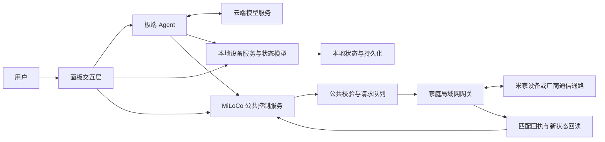

*图 4-1　产品控制通路。*

| 通路 | 说明 | 失效影响 |
| --- | --- | --- |
| 智能通路 | 用户意图经板端 Agent 与云端模型交互，形成工具调用 | 云端不可用影响文字请求；独立触摸入口可继续使用 |
| 本地通路 | 触摸与工具通过设备服务操作本地状态模型 | 独立于外网运行 |
| 米家通路 | 卡片与 Agent 进入同一公共控制服务，再通过家庭网关执行 | 网关不可用时报告米家服务异常 |

米家公共流程为 `control_begin → control_poll → control_release`。公共层核对设备、在线状态、能力、操作类型和值，分配请求 ID，发送前再次检查；卡片与 Agent 共用确认规则，但等待方式不同。

| 操作或结果 | 确认依据与用户反馈 |
| --- | --- |
| 可回读属性写入 | 根据发送后的新状态确认目标值 |
| 云台校准等动作 | 匹配请求的网关动作回执成功，报告“网关已确认动作命令” |
| 不可回读属性写入 | 网关明确接受，说明该属性无法回读 |
| 回执未知但属性可回读 | 新观测与目标一致时报告“当前状态已确认” |
| 传输失败、回执无效或发送后超时 | 报告“执行结果未确认”，不自动重发动作 |

等待上限默认为 10 秒，Agent 同时受整轮剩余时间限制。取消或超时可撤销尚未发送的排队命令；请求结果保留到调用方释放，同一设备同一控制项的重叠请求返回忙碌。

米家设备卡片与 `miot_device_control` 共用以上流程。实现细节见[公共控制与回执说明](CONTROL_RECEIPTS.md)。

### 4.2 产品能力分层

| 层级 | 内容 | 用户感知 |
| --- | --- | --- |
| 交互层 | 首页、房间、对话、设置、系统状态 | 看到什么、点到什么 |
| 智能层 | 对话理解、工具调用、执行反馈 | 一句话能否被正确执行 |
| 设备层 | 本地设备、场景、米家设备 | 设备是否真的动作 |
| 连接层 | Wi-Fi、云端服务、局域网网关 | 在线状态与故障提示 |
| 数据层 | 设备状态、场景、配置、凭据 | 重启后是否保留、凭据是否安全 |

---

## 5. cAGENT 架构

cAGENT 是项目采用的板端 Agent 内核，负责模型交互与工具调用，提供**有界、可裁剪、可替换**的编排框架。界面、网络与设备能力由应用和平台适配层接入。

### 5.1 设计原则

| 原则 | 含义 | 对产品的价值 |
| --- | --- | --- |
| 平台无关 | 核心代码不依赖 RTOS、socket、TLS 或文件系统 | 同一套逻辑可在板端与 PC 上验证 |
| 调用方提供存储 | 工作区与缓冲区由应用传入，核心不做堆分配 | 内存可预算、可裁剪，适合 MCU |
| 全程有界 | 输入、输出、工具参数、历史轮次都有上限 | 超限明确报错，不会静默截断 |
| 同步单轮 | 一次 `agent_run` 完成一轮请求，一次只跑一个 | 行为可预测，便于并发控制 |
| 默认拒绝 | 未安装授权策略时，模型不能调用任何工具 | 设备控制默认安全 |
| 注册即借用 | 工具、上下文、技能、会话存储均为注册后借用 | 应用掌握生命周期，避免隐式拷贝 |

### 5.2 分层结构

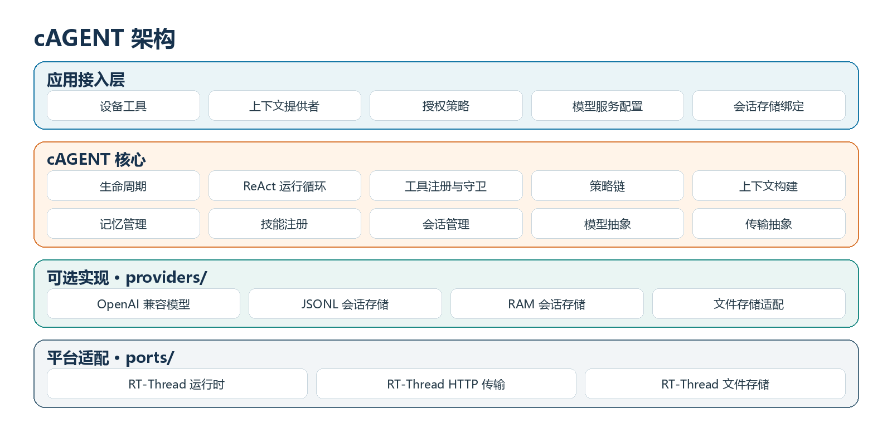

*图 5-1　cAGENT 架构：应用接入、核心、可选实现与平台适配四层。*

各层职责说明：

- **应用接入层**：由产品提供工具、上下文、授权策略、模型配置与会话存储绑定，核心只做编排。
- **cAGENT 核心**：负责生命周期、ReAct 循环、工具注册与守卫、策略链、上下文与记忆、技能、会话、模型与传输抽象，不碰具体平台。
- **可选实现 · providers/**：OpenAI 兼容模型与各类会话存储，按产品需要选择编译。
- **平台适配 · ports/**：把核心需要的时钟、内存、HTTP 与文件能力接到 RT-Thread 上。

### 5.3 主要模块

| 模块 | 职责 | 关键接口 |
| --- | --- | --- |
| `core` | 生命周期、运行状态、事件、错误与内存工作区 | `agent_init` / `agent_start` / `agent_run` / `agent_destroy` |
| `run` | ReAct 循环、取消、超时与单轮统计 | 由 `agent_run` 驱动，产出执行摘要 |
| `model` | 模型调用抽象与响应分发 | 绑定具体模型提供者，如 OpenAI |
| `transport` | 同步 HTTP 传输契约 | 由平台端口实现，核心不感知 socket |
| `tool` | 工具注册、参数校验、调用守卫与结果输出 | `agent_register_tool` / `agent_tool_enumerate` |
| `policy` | 工具调用授权 | `agent_set_policy_callback`，默认拒绝 |
| `context` | 每轮模型输入的上下文注入 | 应用注册提供者，按优先级拼接 |
| `memory` | 长期偏好与事实文档 | 区分指令类与参考类内容 |
| `skill` | 技能说明与场景资源 | 注册后进入上下文 |
| `session` | 会话读写与历史轮次 | `agent_set_session_storage` |
| `runtime` | 时钟、内存与平台服务 | 由端口注入，核心只调用契约 |

### 5.4 一次 `agent_run` 的执行流程

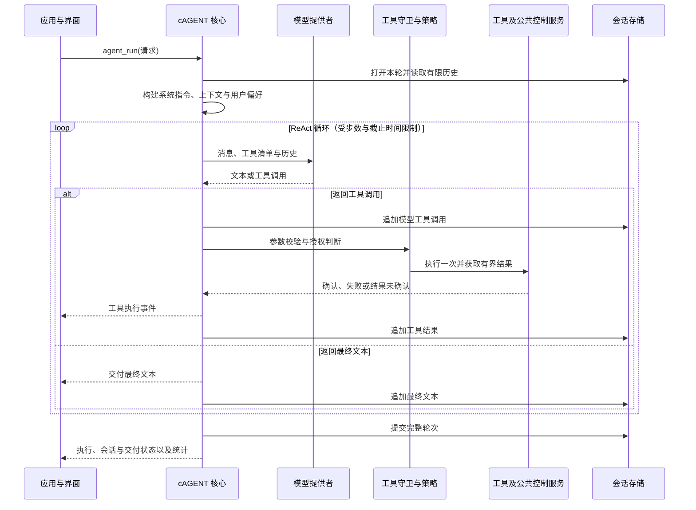

*图 5-2　cAGENT 单轮执行流程。*

工具执行、会话保存与文本交付分别记录状态，便于界面反馈和串口诊断。

### 5.5 扩展点

cAGENT 把变化点收敛为六类注册接口，产品扩展时不需要改核心：

| 扩展点 | 扩展方式 | 本项目的用法 |
| --- | --- | --- |
| 工具 | 注册名称、描述、参数 Schema 与执行函数 | 灯光、插座、场景、米家设备控制 |
| 上下文 | 注册按优先级构建的文本提供者 | 设备清单、家庭信息、场景说明 |
| 策略 | 安装授权回调 | 按工具与参数决定是否允许执行 |
| 模型 | 绑定模型提供者 | OpenAI 兼容提供者，支持预设后端与自定义端点 |
| 传输 | 注入 HTTP 传输实现 | 复用项目统一的 HTTP/HTTPS 客户端 |
| 会话 | 绑定会话存储 | 完整轮次以 JSONL 写入 LittleFS，供后续对话与历史浏览 |

### 5.6 在本项目中的落地方式

- **运行位置**：Agent 运行在独立工作线程，界面只提交请求和接收结果，不阻塞渲染。
- **模型接入**：使用 OpenAI 兼容提供者，包含 DeepSeek、MiMo、Qwen、OpenAI 及 Custom 预设；服务地址、模型与密钥由设置页配置。
- **工具范围**：本地设备工具与米家设备工具分别注册，按来源校验目标。
- **调用授权**：通过策略控制工具权限，并校验参数与值域。
- **上下文控制**：设备清单和场景信息按需注入，避免把整份家庭数据塞进每轮请求。
- **历史管理**：投影最近 3 轮作为模型历史，磁盘按最多 20 个完整轮次及文件预算整理。
- **结果处理**：模型、传输、工具、会话与文本交付分别诊断；米家工具根据公共控制服务回执返回结果。

### 5.7 会话历史、用户偏好与容量

Session 保存对话与工具消息；用户偏好 Memory 单独保存用户要求记住的内容，通过 `user_memory` 工具记住、列出或删除，并注入后续对话上下文。

容量统一定义在 `port/sca_agent_profile.h`，固件与宿主测试使用同一配置。以下是当前关键预算：

| 项目 | 当前容量或限制 |
| --- | --- |
| Core 工作区 | 96 KiB，包含 64 KiB scratch |
| 模型请求 / HTTP 响应 / 解码缓冲 | 64 / 16 / 8 KiB |
| 输入 / 上下文 / 工具输出 / 模型输出 | 2 / 8 / 4 / 4 KiB |
| 单轮 JSONL 读写缓冲 | 读、写各 128 KiB，容纳完整轮次及 JSON 转义开销 |
| 会话 payload 解码 / 文件预算 | 64 KiB / 1 MiB |
| 历史投影 / 磁盘保留上限 | 3 轮 / 20 轮，实际保留还受文件预算限制 |
| 工具槽 / 投影消息数 | 24 / 48 |
| 工具描述字段 | 默认上限 256 字节 |

`[agent_profile]` 打印容量配置；`[agent_diag]` 记录工具名、调用 ID、失败阶段、实际/所需字节数与容量；`[control]` 用请求 ID 关联提交、HTTP、确认及释放。

完整预算与日志字段见[容量与诊断说明](CAPACITY_DIAGNOSTICS.md)。

---

## 6. 工程架构

### 6.1 总工程架构

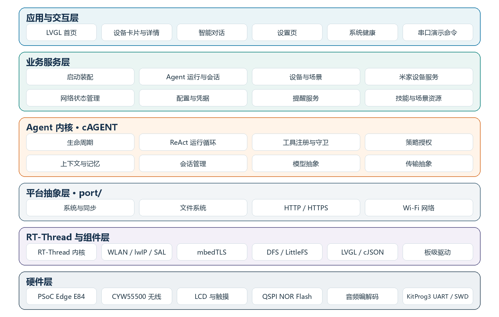

*图 6-1　总工程架构：六层职责划分。*

各层职责说明：

- **应用与交互层**：用户可见的界面与现场操作入口，只负责展示与交互，不直接访问设备或网络。
- **业务服务层**：装配产品能力，组织设备、场景、米家、网络、配置、提醒与技能资源等家庭服务。
- **Agent 内核 · cAGENT**：平台无关的 ReAct 编排、工具注册与守卫、策略授权、上下文与记忆、会话与模型抽象。
- **平台抽象层 · port/**：封装线程、文件、HTTP 与 Wi-Fi 等系统能力。
- **RT-Thread 与组件层**：提供操作系统内核、网络协议栈、加密、文件系统与图形中间件。
- **硬件层**：Edgi-Talk 板卡的双核 SoC、无线模组、显示与触摸、存储和调试接口。

业务层以平台抽象接口调用系统能力，便于板端适配和宿主测试。

### 6.2 目录与模块职责

```text
edgi_smart_home/
├─ applications/          应用入口、启动装配、串口命令
├─ board/                 板级适配：屏幕、触摸、音频、存储、Wi-Fi
├─ port/                  平台抽象：系统、文件、HTTP、网络
├─ packages/cagent/       Agent 内核：核心、模型、存储、平台端口
├─ smart_home/
│  ├─ core/               应用装配与生命周期
│  ├─ agent/              Agent 运行、模型后端、会话、权限
│  ├─ device/             设备、房间、场景、状态事件与保存
│  ├─ miloco/             米家网关接入：发现、能力、控制、回读
│  ├─ net/                网络状态、自动连接、时间同步
│  ├─ tools/              提供给 Agent 的设备工具
│  ├─ ui/                 LVGL 页面与交互逻辑
│  ├─ config/             配置与凭据存储
│  ├─ skills/             场景目录与技能资源加载
│  ├─ memory/             用户偏好保存与上下文注入
│  └─ reminder/           提醒引擎与持久化
├─ resources/skills/      运行时技能与场景资源
├─ tests/                 宿主测试与米家 Mock 服务
└─ tools/                 资源部署、演示检查、界面检查
```

| 模块 | 职责 | 对外表现 |
| --- | --- | --- |
| `applications` | 启动顺序、系统装配、串口演示入口 | 上电后系统可用、可自检 |
| `core` | 应用生命周期与模块装配 | 各服务按顺序启动与安全退出 |
| `agent` | 组织模型对话、工具调用、会话与权限 | 对话能落到真实设备 |
| `device` | 设备模型、房间、场景、状态事件 | 首页卡片与设备状态一致 |
| `miloco` | 米家设备发现、能力解析、控制与回读 | 米家设备可统一管理 |
| `net` | Wi-Fi 生命周期、联网状态、时间同步 | 网络状态可见、可恢复 |
| `tools` | 将设备能力暴露给 Agent | 模型可安全调用设备能力 |
| `ui` | 页面、组件、异步刷新 | 操作流畅、状态实时 |
| `config` | 配置与凭据的读写 | 重启保留、凭据不外泄 |
| `skills` | 场景与技能资源 | 场景可配置、可扩展 |
| `memory` | 用户明确要求保存的偏好与事实 | 记住、列出、忘记，与 Session 历史独立 |
| `reminder` | 提醒调度与数据保存 | 独立后台提醒服务 |

### 6.3 启动顺序

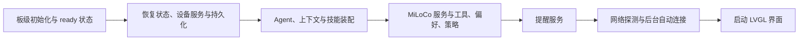

*图 6-2　应用启动流程。*

设备服务、Agent 和 MiLoCo 由 `smart_home_agent_app_init` 装配，成功后启动提醒、网络与界面。网络连接在后台进行；Agent 工作区或关键工具注册失败时返回启动错误。

### 6.4 状态与数据

| 数据 | 作用 | 保存与应用策略 |
| --- | --- | --- |
| 本地设备、房间与场景状态 | 恢复本地模型与界面组织 | 变更后合并保存 |
| 网络、模型与网关配置 | 连接参数与后端选择 | 支持运行时保存与应用 |
| 凭据 | Wi-Fi、模型与网关鉴权 | 凭据文件与普通配置分开管理 |
| Session 历史 | 后续对话与历史浏览 | `/littlefs/smart_home/sessions/`，仅提交完整轮次；不重放工具 |
| 用户偏好 Memory | 用户要求长期保存的偏好 | `/littlefs/smart_home/user_memory.json`，与 Session 独立 |
| 提醒记录 | 提醒服务恢复 | 由提醒模块保存与加载 |
| 技能与场景资源 | 操作说明与场景目录 | `/littlefs/res/skills/`，随版本部署；缺少资源与格式错误分别处理 |

### 6.5 可靠性设计

- **运行期降级**：云端、网络或米家故障按服务报告，本地状态模型与触摸入口独立运行。
- **结果确认**：可读属性核对新状态，动作核对网关回执，只写属性报告网关接受。
- **配置不误删**：演示复位只恢复本地演示数据，不动网络、模型与网关凭据。
- **变更可追踪**：设备状态带版本号，界面与存储使用同一份状态来源。
- **诊断可关联**：工具调用 ID 与控制请求 ID 关联，定位启动、模型、控制、会话与交付错误。
- **演示与自检**：提供演示复位和自检命令，便于现场操作。

---

## 7. 产品界面与演示流程

### 7.1 实机照片

以下为 Edgi-Talk 实机运行照片，拍摄内容包括首页、设备详情、智能对话与设置页面。

| 首页：房间与设备卡片 | 设备详情：米家摄像头 |
| --- | --- |
| 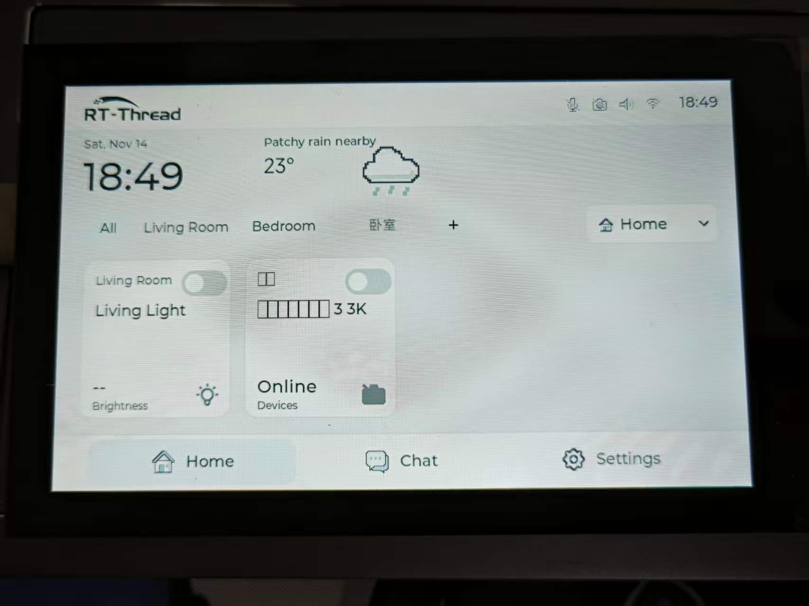 | 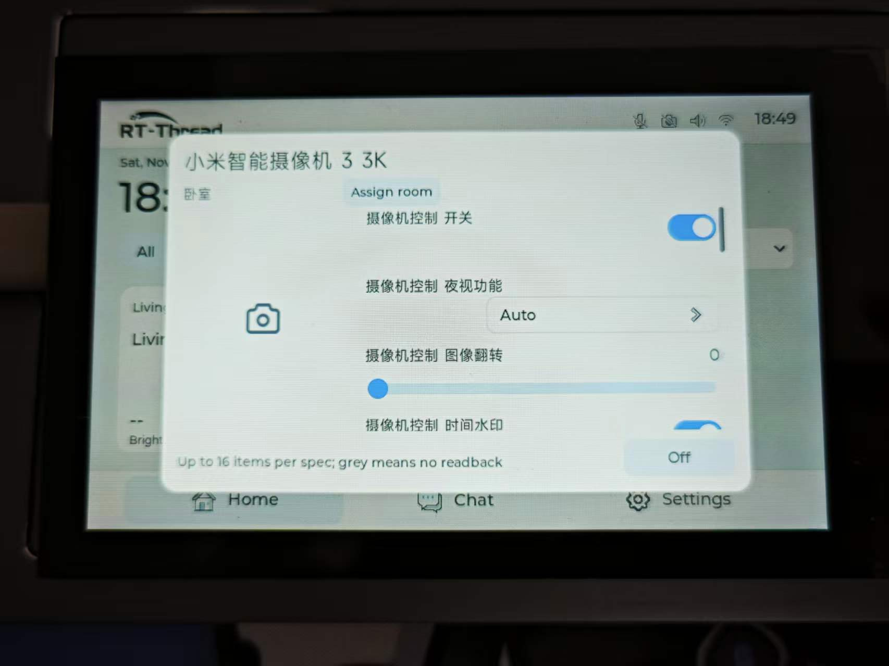 |
| *图 7-1　实机首页与设备卡片。* | *图 7-2　实机摄像头控制详情。* |
| 首页展示时间、天气、房间筛选、本地演示灯光和米家摄像头卡片。 | 摄像头详情展示设备名称、所属房间及开关、夜视、图像翻转、时间水印等控制项。 |

| 智能对话：云台校准结果 | 设置：工具权限 |
| --- | --- |
| 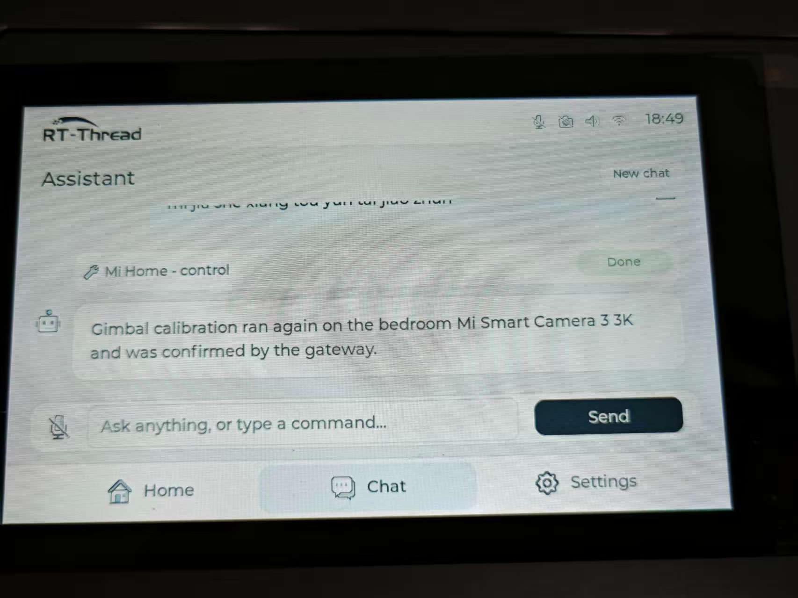 | 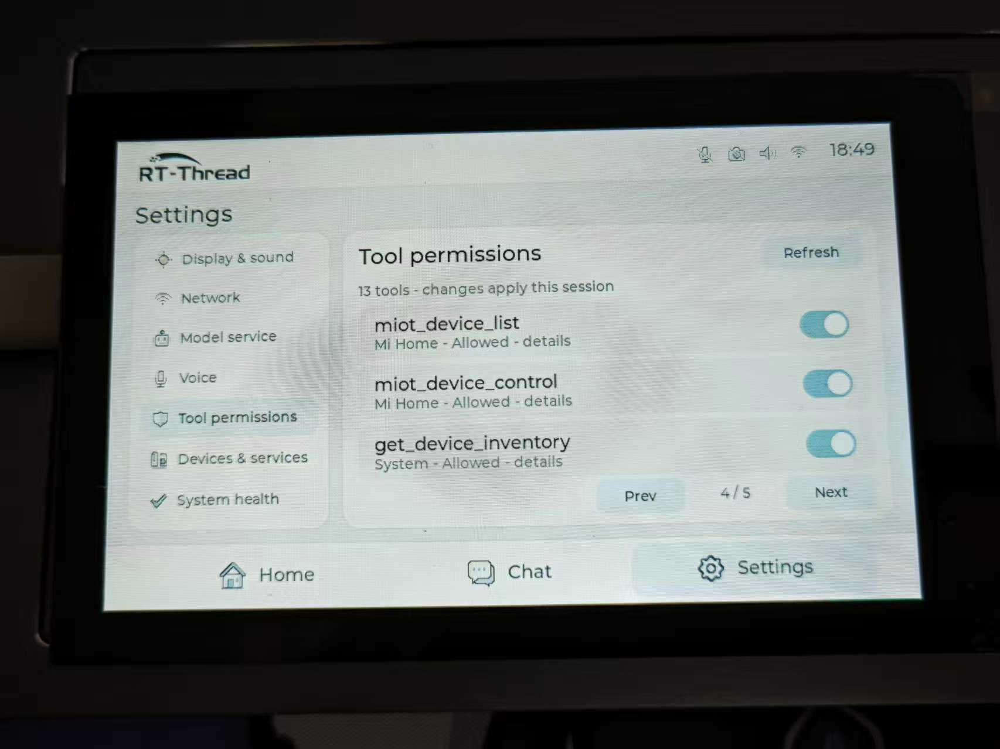 |
| *图 7-3　实机云台校准对话。* | *图 7-4　实机工具权限设置。* |
| 对话中展示米家控制工具执行状态，并反馈云台校准命令的网关确认结果。 | 按工具设置本次会话的调用权限，支持米家设备列表、设备控制和设备清单等工具。 |

| 设置：Wi-Fi 连接状态 | 米家接入：等待授权与网关异常提示 |
| --- | --- |
| 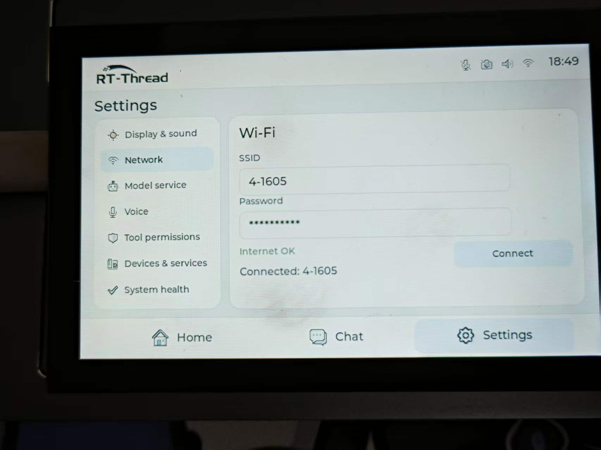 | 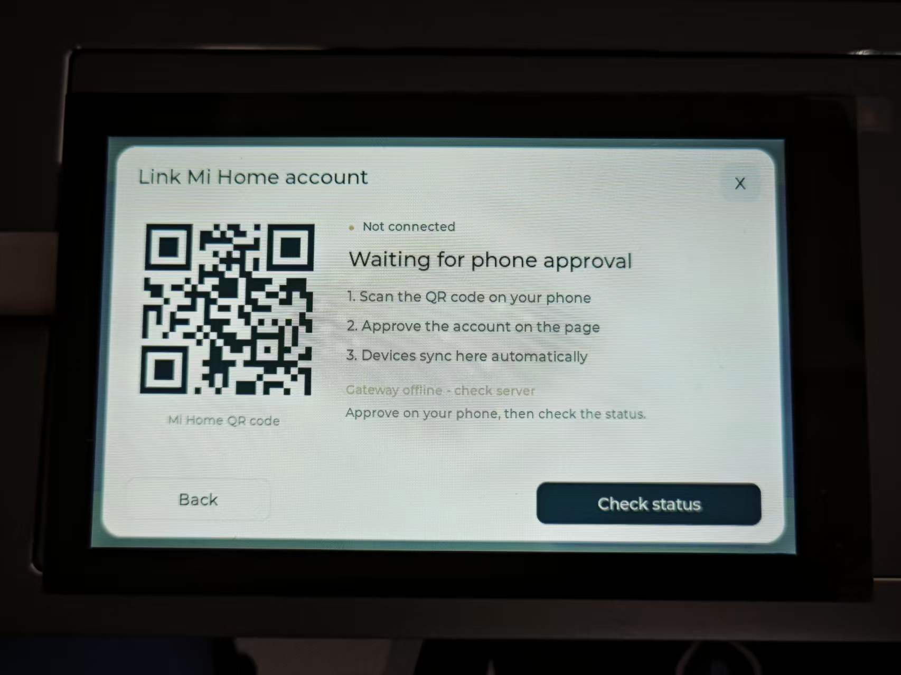 |
| *图 7-5　实机Wi-Fi网络设置。* | *图 7-6　实机米家账号绑定。* |
| 在页面内填写 Wi-Fi 名称与密码、发起连接并查看网络状态。 | 提供绑定二维码、手机授权引导与状态查询；图中显示等待授权和网关离线提示。 |

### 7.2 设计稿与历史固件导出

#### 7.2.1 产品设计稿

以下为中文版产品设计稿，展示页面布局与交互设计。

| 首页：房间与设备总览 | 智能对话：指令与工具轨迹 |
| --- | --- |
| 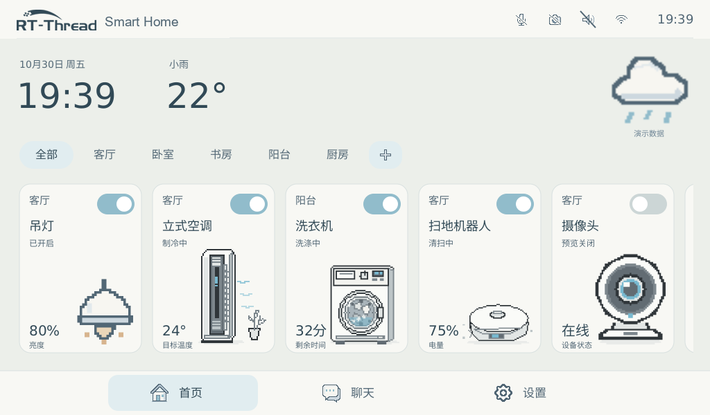 | 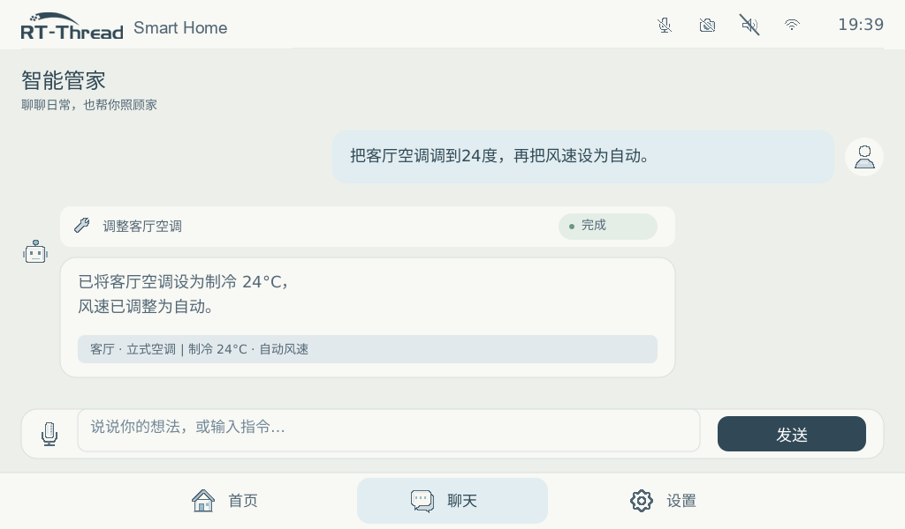 |
| *图 7-7　设计稿首页设备总览。* | *图 7-8　设计稿智能对话。* |
| 顶部显示时间、天气与网络状态；中部按房间筛选设备卡片，直接展示开关、亮度、温度等关键状态。 | 用户输入指令后，对话流中先出现工具执行卡片，再给出结果说明，底部保留语音与文字输入入口。 |

| 设备详情：连续调节 | 网络连接：Wi-Fi 配置与状态 |
| --- | --- |
| 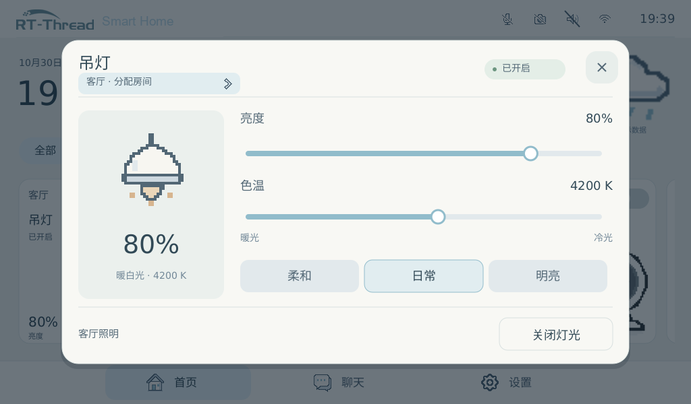 | 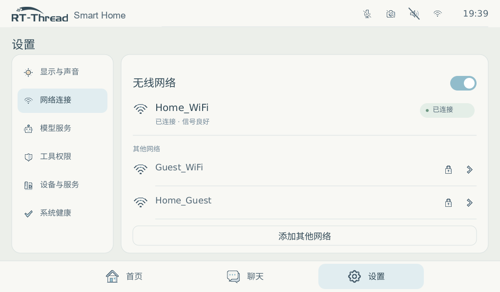 |
| *图 7-9　设计稿设备控制详情。* | *图 7-10　设计稿网络连接。* |
| 点按设备卡片进入详情，可连续调节亮度与色温，并提供柔和、日常、明亮等快捷档位。 | 展示当前连接、信号质量与其他网络，支持页面内添加网络并回显连接结果。 |

| 米家接入：账号与设备同步 | 系统健康：服务级状态 |
| --- | --- |
| 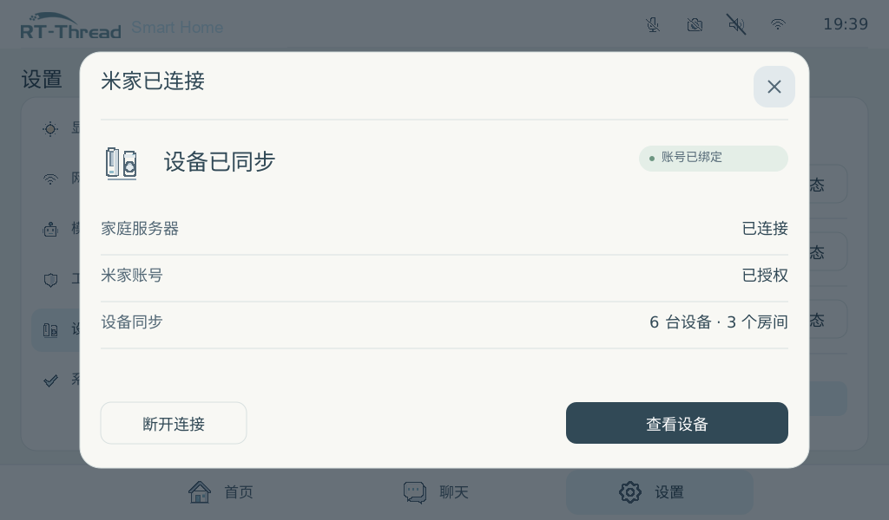 | 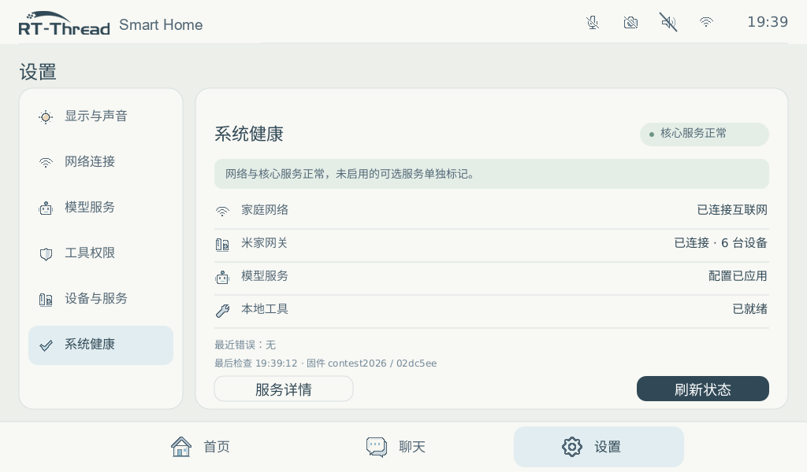 |
| *图 7-11　设计稿米家接入。* | *图 7-12　设计稿系统健康。* |
| 完成网关与账号绑定后，展示同步的设备与房间数量，可一键查看已同步设备或断开连接。 | 分别展示网络、米家网关、模型服务与本地工具状态，故障定位不依赖单一“是否在线”。 |

#### 7.2.2 历史固件导出

以下为 800×480 固件帧缓冲导出图，展示首页和设置页。

| 首页：设备卡片与房间筛选 | 首页：场景切换 |
| --- | --- |
| 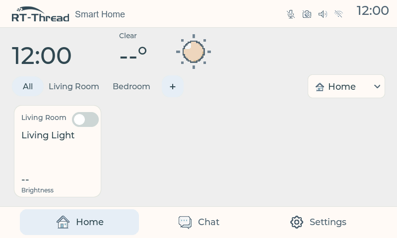 | 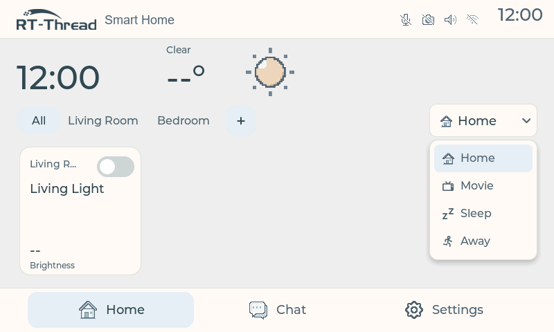 |
| *图 7-13　固件导出首页。* | *图 7-14　固件导出场景菜单。* |
| 顶栏为品牌标识与时钟，中部按房间筛选设备，卡片直接展示开关与亮度状态。 | 右上角场景菜单提供 Home / Movie / Sleep / Away 四种预设。 |

| 设置：网络连接 | 设置：显示与声音 |
| --- | --- |
| 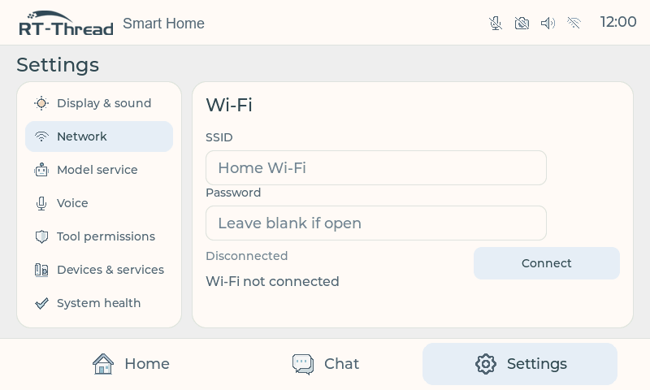 | 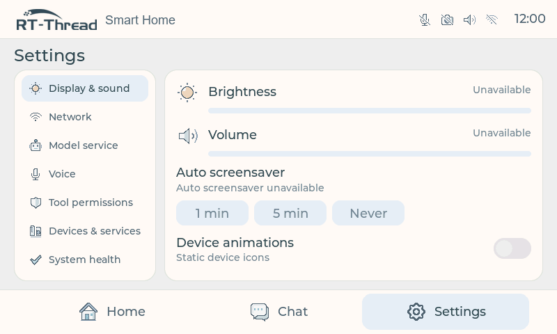 |
| *图 7-15　固件导出网络设置。* | *图 7-16　固件导出显示与声音设置。* |
| 展示 Wi-Fi 名称、密码输入与连接状态。 | 展示显示与声音设置项及可用状态。 |

### 7.3 本地能力演示

1. 上电启动，进入首页，查看房间与设备卡片。
2. 点按本地演示设备卡片，观察状态与界面变化。
3. 执行演示复位与自检，确认设备恢复到初始状态且控制链路正常。

### 7.4 智能对话演示

1. 在设置页完成 Wi-Fi 配置，确认网络在线。
2. 配置模型服务，确认服务可用。
3. 输入设备控制指令，查看工具调用状态与最终回复。

### 7.5 米家设备演示

1. 在设置页填写家庭局域网网关信息。
2. 完成账号绑定并从网关同步设备，查看其能力项。
3. 通过设备卡片或对话执行操作，查看控制反馈与设备状态。
4. 断开网关，确认仅米家设备受影响，本地控制仍可用。

### 7.6 降级演示

| 演示动作 | 预期表现 |
| --- | --- |
| 断开外网 | 文字请求报告连接或模型错误，本地状态模型与触摸入口继续运行 |
| 模型服务异常 | 提示服务不可用，界面可继续操作 |
| 网关不可达 | 米家设备标记异常，本地设备不受影响 |
| 重启设备 | 加载已保存的本地模型、配置与历史 |
